# Informe TP2 — Clustering (Candy Power Ranking)

**Dataset:** *Candy Power Ranking* de FiveThirtyEight (85 golosinas, 13 variables).
**Archivo:** `candy-data.csv`. **Código:** carpeta `code/`.

---

## Identificación de variables

| Rol | Columnas |
|---|---|
| **Identificador** | `competitorname` (nombre; se usa solo como etiqueta en gráficos) |
| **Binarias (0/1)** | `chocolate`, `fruity`, `caramel`, `peanutyalmondy`, `nougat`, `crispedricewafer`, `hard`, `bar`, `pluribus` |
| **Continuas (percentiles)** | `sugarpercent`, `pricepercent` ∈ [0, 1] |
| **Variable de análisis** | `winpercent` ∈ [0, 100]: popularidad de la golosina en las encuestas originales |

Como el clustering es no supervisado, `winpercent` se trata de dos formas: se **excluye** de los features (escenario `comp`, 11 columnas) y se **incluye** (escenario `full`, 12 columnas), para evaluar si la popularidad cambia la estructura de grupos.

---

## 1. Análisis exploratorio

Script: `exploratorio.py`. El dataset no tiene nulos (85 × 13).

### 1.1 Frecuencia de features binarios
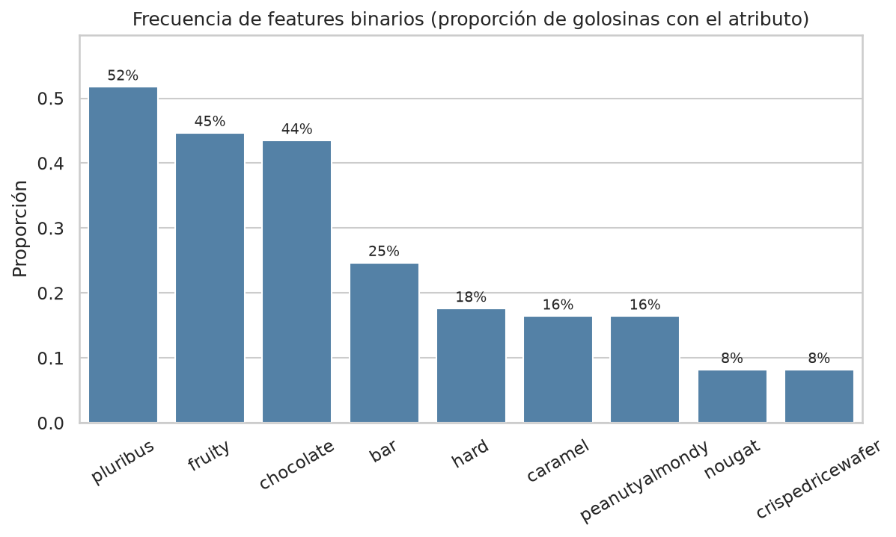

Los atributos más comunes son `pluribus` (52 %, viene en bolsa con muchas unidades), `fruity` (45 %) y `chocolate` (44 %). Los más raros: `nougat` y `crispedricewafer` (8 % c/u).

### 1.2 Distribución de las continuas
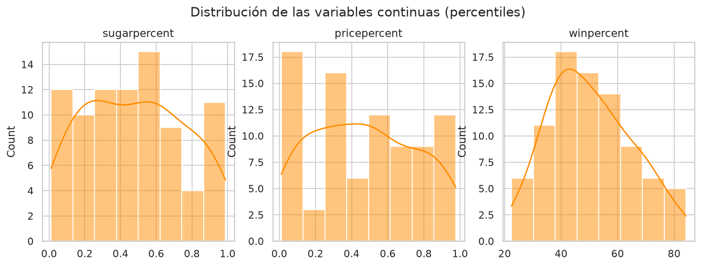

Las tres variables continuas cubren casi todo su rango sin asimetrías extremas (medias ≈ 0.48, 0.47 y 50.3).

### 1.3 Matriz de correlación
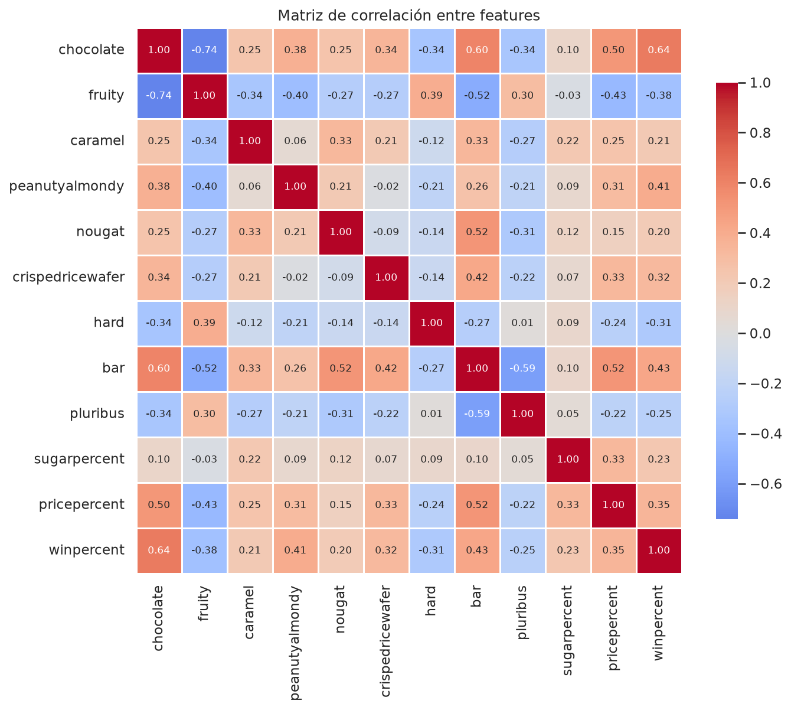

| Par | ρ | Lectura |
|---|---|---|
| `fruity` ↔ `chocolate` | **−0.74** | Casi excluyentes: una golosina es de chocolate *o* frutal |
| `chocolate` ↔ `bar` | 0.60 | El chocolate suele venir en barra |
| `bar` ↔ `pluribus` | −0.59 | Formato barra vs. bolsa, excluyentes |
| `chocolate` ↔ `winpercent` | **0.64** | El chocolate es el predictor más fuerte de popularidad |
| `pricepercent` ↔ `chocolate` / `bar` | 0.50 / 0.52 | Las barras de chocolate son más caras |

### 1.4 winpercent vs. azúcar y precio
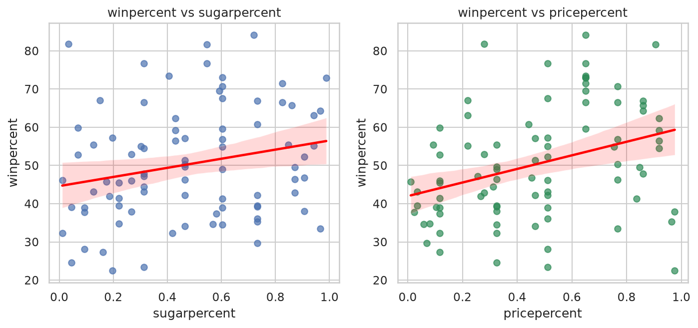

`winpercent` crece débilmente con `pricepercent` (ρ = 0.35) y apenas con `sugarpercent` (ρ = 0.23): la popularidad se explica más por la **composición** (chocolate) que por lo dulce o lo caro.

---

## 2. Metodología

1. **Escenarios:** `X_comp` (11 features, sin `winpercent`) y `X_full` (12 features, con `winpercent`).
2. **Escalado:** `StandardScaler` sobre todas las columnas. Indispensable porque `winpercent` (0–100) dominaría cualquier distancia euclídea frente a los binarios (0/1) y los percentiles (0–1), y porque el `eps` de DBSCAN solo es interpretable sobre datos escalados.
3. **Métricas internas** (no hay ground truth): **silhouette** (mayor mejor), **Calinski-Harabasz** (mayor mejor), **Davies-Bouldin** (menor mejor). En DBSCAN se calculan excluyendo el ruido.
4. **Adjusted Rand Index (ARI)** para comparar asignaciones entre métodos, entre linkages y entre escenarios (1 = idénticas, 0 = azar).

---

## 3. Clustering jerárquico: single vs. complete vs. average

Script: `hierarchical.py`. Distancia euclídea + `scipy.cluster.hierarchy.linkage`.

### 3.1 Dendrogramas
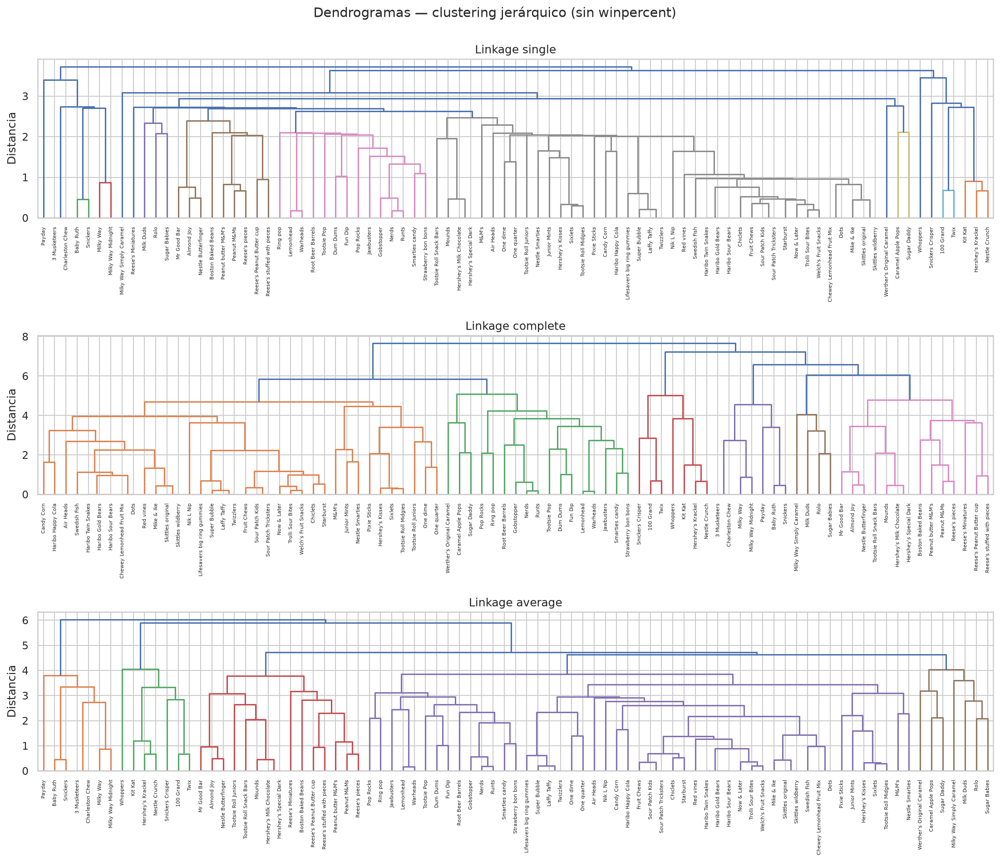
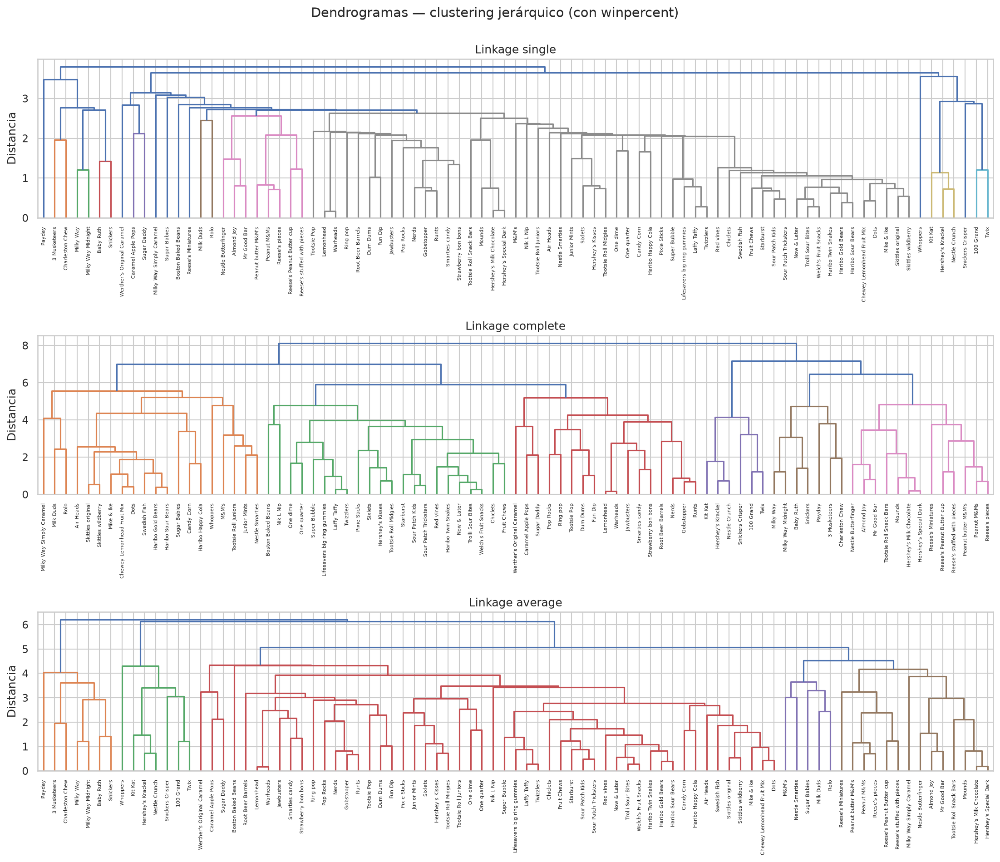

- **single**: encadenamiento típico (*chaining*): los puntos se van agregando de a uno a un gran grupo; cortes poco informativos.
- **complete**: árbol muy compacto y balanceado, pero "comprime" distancias (todo fusiona entre 4 y 8).
- **average**: estructura intermedia, con fusiones bien escalonadas.

### 3.2 Correlación cofenética

| Linkage | comp | full |
|---|---|---|
| single | 0.840 | 0.814 |
| complete | 0.806 | 0.717 |
| **average** | **0.871** | **0.866** |

**average** es el más fiel a las distancias originales en ambos escenarios → es el linkage que se usa para el resto del análisis.

### 3.3 Elección del corte
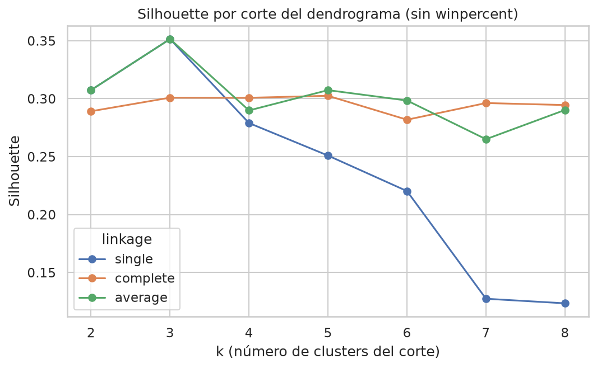
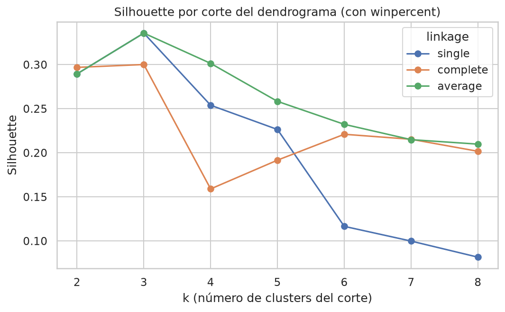

El silhouette máximo se da en **k = 3** con average (0.351 en comp, 0.336 en full). Cortando a k = 3:

- **single ≡ average** (ARI = 1.000): producen exactamente la misma partición (grupos de 7, 7 y 71).
- **complete** difiere (ARI = 0.41 en comp, 0.48 en full): reparte distinto el grupo grande.
- **Agregar `winpercent` no cambia nada**: ARI comp vs. full = 1.000. La popularidad es redundante con la composición (ya vimos que chocolate la predice).

### 3.4 Interpretación del corte elegido
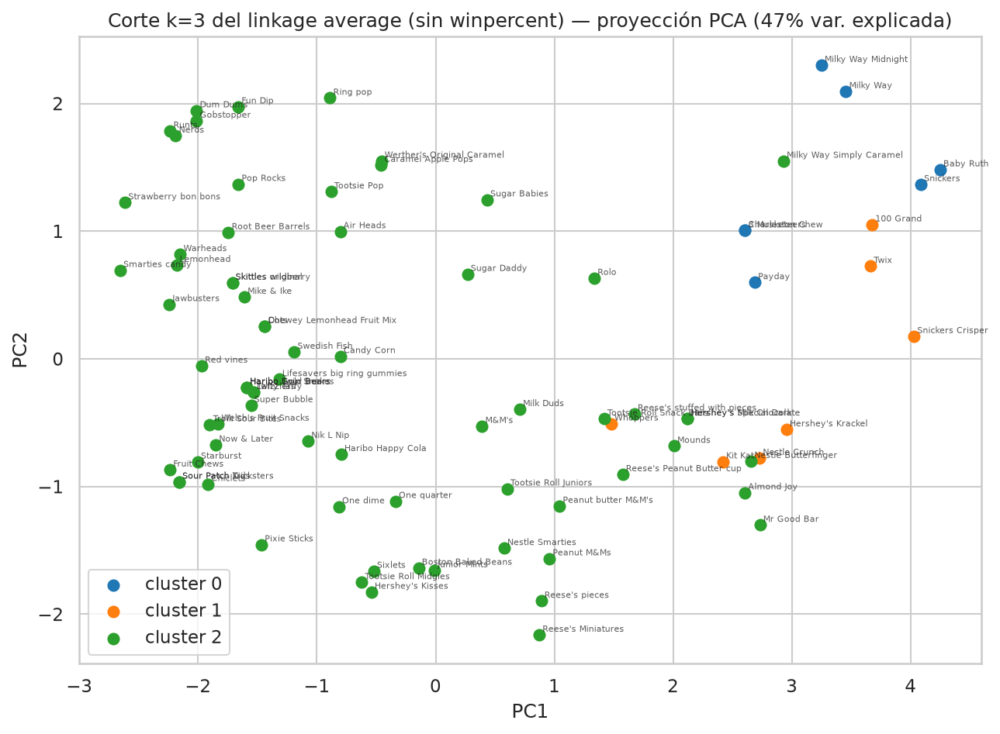

| Cluster | n | Descripción |
|---|---|---|
| 0 | 7 | Barras de chocolate con nougat (Snickers, Milky Way, 3 Musketeers…) |
| 1 | 7 | Chocolate premium/carísimo (100 Grand, Twix, Whoppers, Kit Kat…) |
| 2 | 71 | Todo el resto (frutales + chocolate estándar mezclados) |

Métricas (comp): silhouette 0.351, CH 18.6, DB 1.00. El jerárquico encuentra dos **nichos** muy coherentes pero deja un cluster residual enorme: es bueno detectando extremos, malo balanceando.

---

## 4. K-means: discusión de distintos K

Script: `kmeans.py` (`n_init=20`, `random_state=42`).

### 4.1 Selección de K
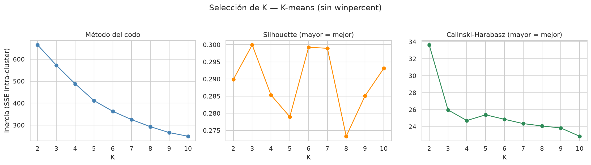
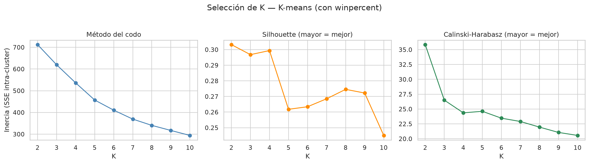

- **Codo**: la inercia decrece suavemente; quiebre leve en K = 3–4 (no hay un codo nítido).
- **Silhouette**: máximo en **K = 3** para comp (0.300) y en **K = 2** para full (0.303), con valores bastante planos (0.27–0.30) → la estructura no es fuertemente "clusterizable".
- **Calinski-Harabasz**: máximo en K = 2 en ambos; decrece monótonamente.

**Discusión:** K = 2 separa simplemente chocolate vs. no-chocolate (es lo que manda CH). K = 3 subdivide el grupo del chocolate en dos (barras con nougat vs. resto), con silhouette comparable y mayor riqueza interpretativa. K ≥ 4 fragmenta grupos coherentes sin ganar silhouette (ARI entre K y K+1 cae a 0.45–0.67: las particiones se vuelven inestables). Se elige **K = 3 (comp)** y **K = 2 (full)** por máximo silhouette, quedándonos con K = 3 como partición de referencia por su interpretabilidad.

### 4.2 Caracterización (comp, K = 3)
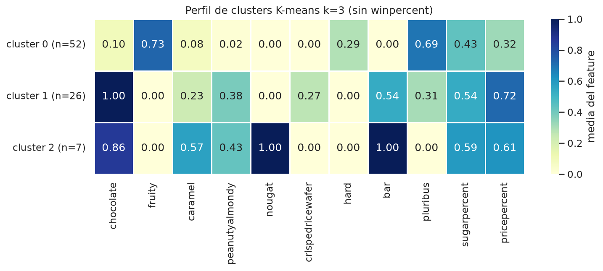
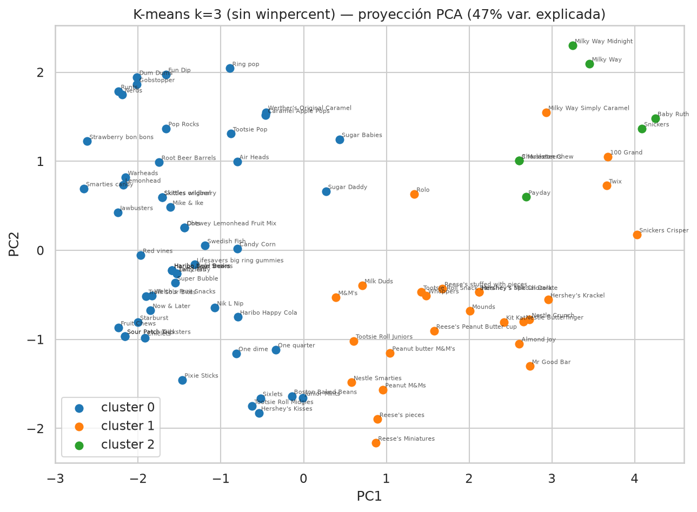

| Cluster | n | Perfil | winpercent medio |
|---|---|---|---|
| 0 | 52 | Frutales/pluribus, baratas (fruity 0.73, pluribus 0.69, price 0.32) | **42.7** |
| 1 | 26 | Chocolate estándar (chocolate 1.00, price 0.72) | **63.0** |
| 2 | 7 | Barras de chocolate + nougat (nougat 1.00, bar 1.00) | **60.1** |

Aunque `winpercent` **no** se usó para clusterizar, separa claramente los grupos: las golosinas de chocolate son ~20 puntos más populares que las frutales. El clustering "redescubrió" la variable de popularidad a partir de la composición.

### 4.3 Escenario full (K = 2)
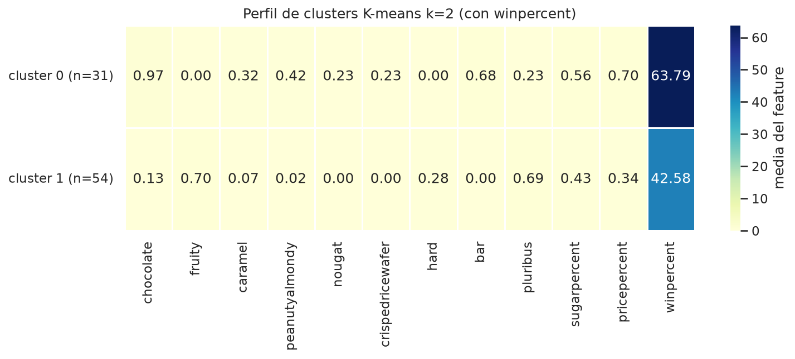

Con `winpercent` incluido, K = 2: chocolate+popular (n = 31, win 63.8) vs. resto (n = 54, win 42.6). El ARI entre las mejores particiones comp vs. full es **0.821**: `winpercent` refuerza la señal del chocolate pero no redefine los grupos.

---

## 5. DBSCAN: discusión de hiperparámetros

Script: `dbscan.py`.

### 5.1 k-distance plot
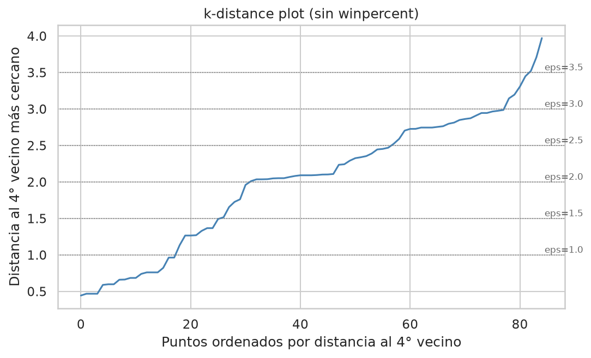
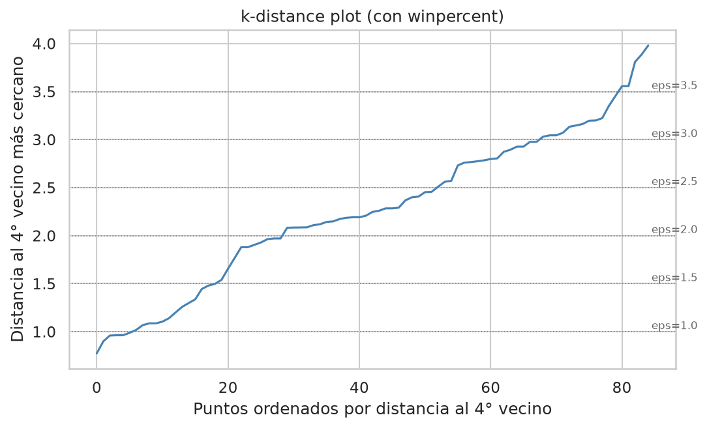

La curva de distancia al 4° vecino no tiene una rodilla abrupta: crece gradual hasta ~2.5 y se empina recién cerca de 3.0 → eps razonable ∈ [2.5, 3.5]. La ausencia de rodilla nítida ya anticipa que **no hay estructura de densidad clara**.

### 5.2 Grid eps × min_samples
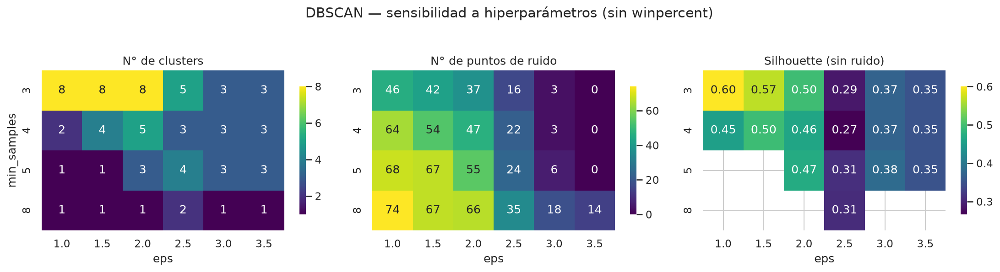
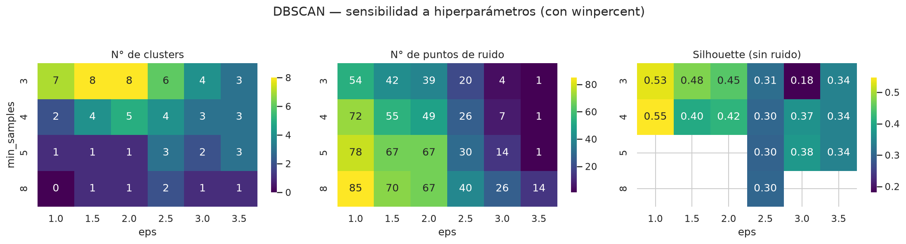

| Región | Comportamiento |
|---|---|
| eps chico (≤ 1.5) | Muchos clusters diminutos + muchísimo ruido (37–74 pts). Silhouette alto **engañoso**: se calcula solo sobre los pocos puntos no-ruido. |
| eps medio (2–2.5) | Transición: baja el ruido, aparecen 3–6 clusters, silhouette cae. |
| eps grande (≥ 3) | 3 clusters + casi nada de ruido; estructura similar a k-means/jerárquico. |
| min_samples alto (8) | Colapsa casi todo a ruido (hasta 85/85): el dataset es chico y no alcanza la densidad exigida. |

**Discusión:** el máximo silhouette crudo (comp: eps = 1.0, ms = 3 → 8 clusters, **46 de 85 puntos marcados como ruido**, silhouette 0.60) es una solución **degenerada**: DBSCAN "premia" descartar la mitad del dataset. Imponiendo ruido ≤ 25 % se obtienen configuraciones **usables**:

| Escenario | Config | Clusters | Ruido | Silhouette |
|---|---|---|---|---|
| comp | eps = 3.0, ms = 5 | 3 (73/6/6) | 6 | 0.382 |
| full | eps = 3.0, ms = 5 | 2 (80/5) | 14 | 0.376 |

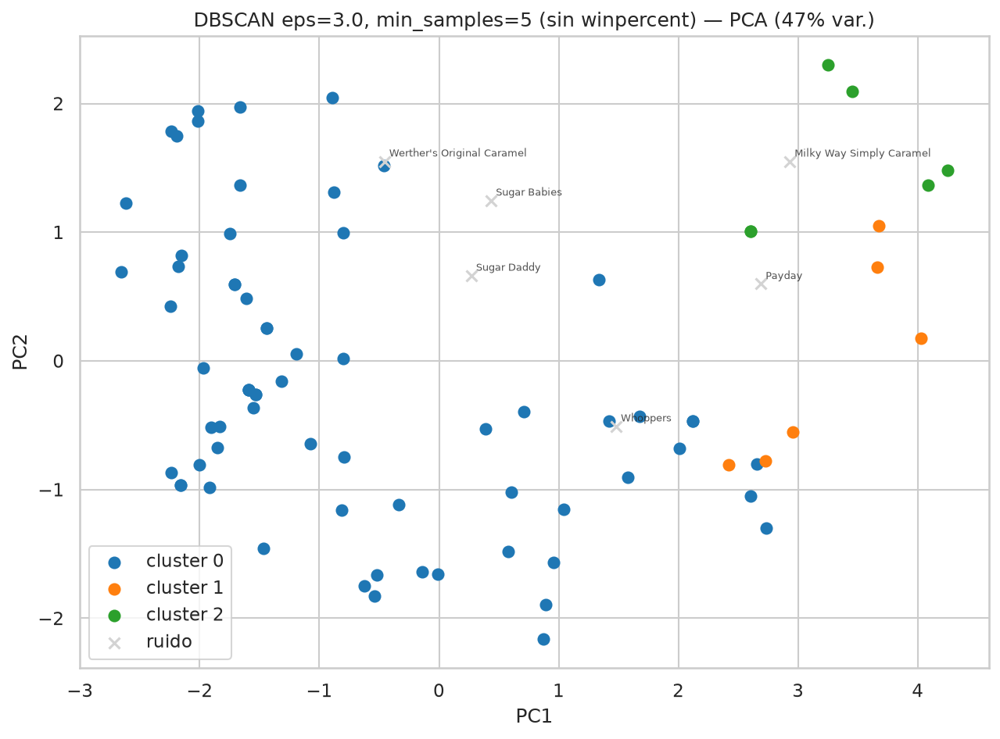

En comp, el cluster grande (73) concentra lo frutal+chocolate estándar y los dos chicos (6+6) son nichos de chocolate premium/barras; el ruido son golosinas "de frontera" (ej. Sugar Daddy, One dime). ARI comp vs. full = 0.921. **Conclusión:** con 85 puntos en 11–12 dimensiones no hay densidades diferenciadas fuertes; DBSCAN solo funciona con eps "generoso" y termina reproduciendo (peor) lo que k-means ya daba. Su valor aquí es detectar **outliers**, no particionar.

---

## 6. PCA + clustering

Script: `pca_clustering.py`.

### 6.1 Varianza explicada
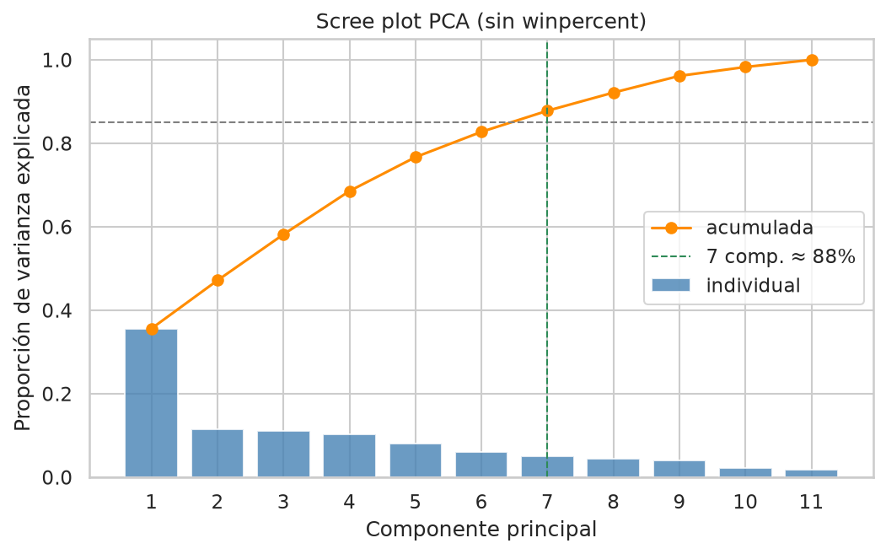


Con features binarios la varianza se reparte mucho: PC1+PC2 = **47 %** y se necesitan **7 componentes para el 85 %**. PCA comprime poco (esperable con variables 0/1 casi ortogonales).

### 6.2 Loadings
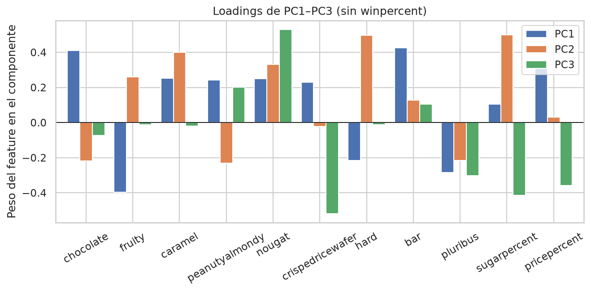
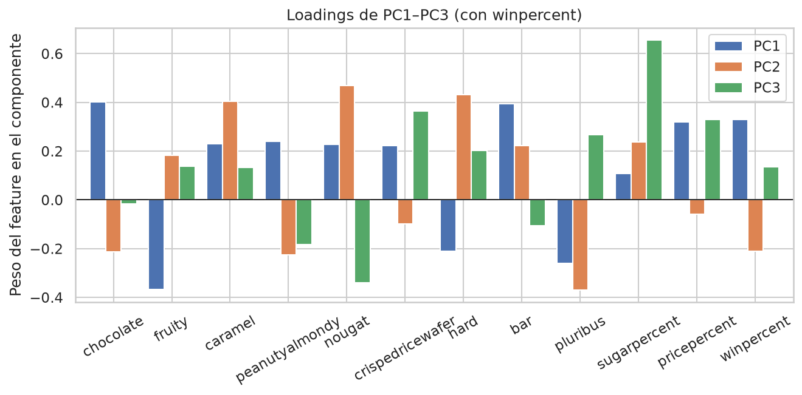

- **PC1 (36 %)**: eje *chocolate + bar + pricepercent* (+) vs. *fruity + pluribus* (−). Es el eje "tipo de golosina".
- **PC2 (12 %)**: *sugarpercent + hard + caramel + nougat* (textura/dulzor).
- **PC3**: mezcla de nougat vs. crispedricewafer/sugar.

### 6.3 Clustering en el espacio PCA
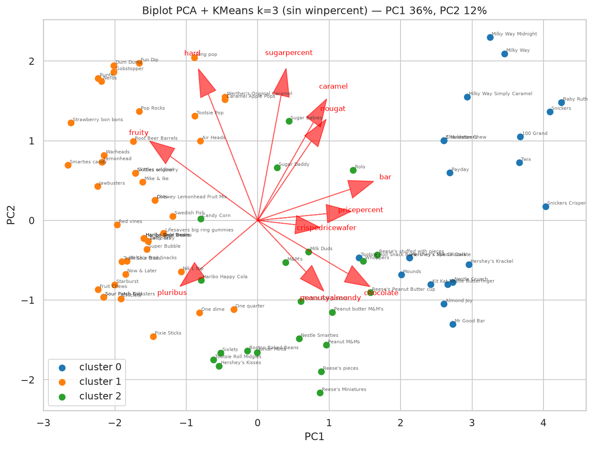
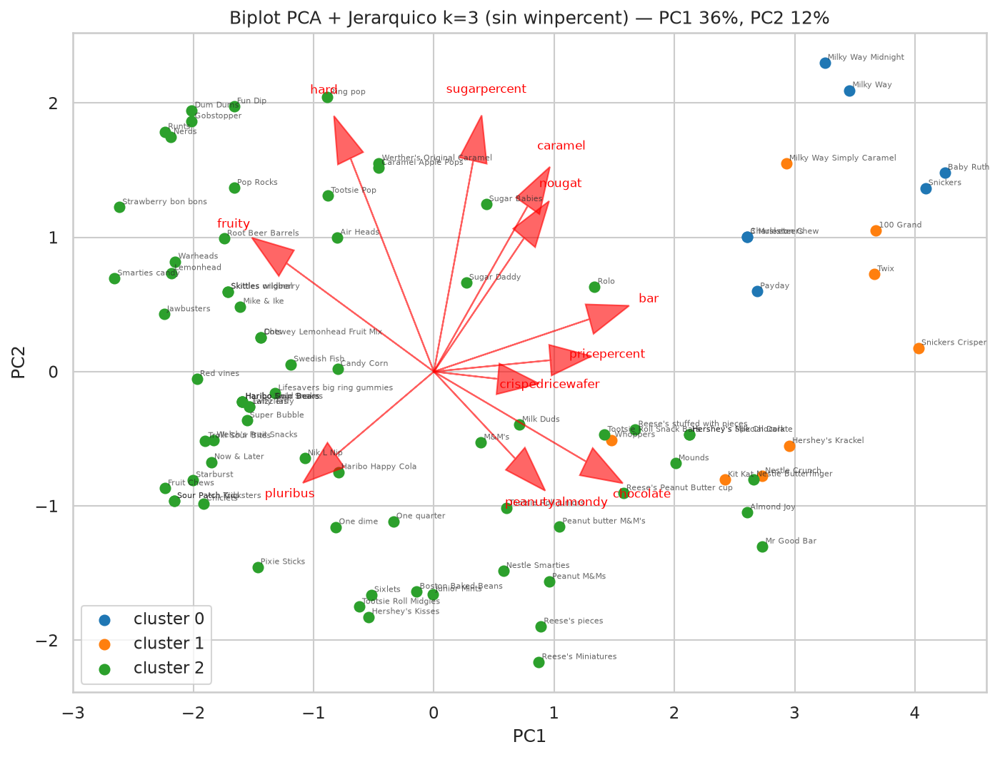
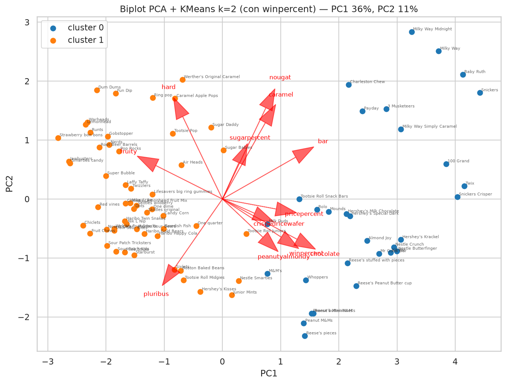
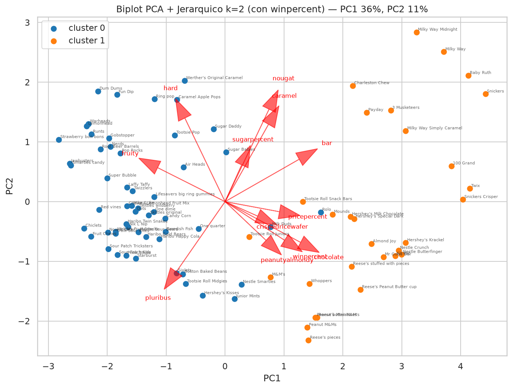

Clustering sobre las 7 componentes (85 % varianza), comparado con el clustering en el espacio original:

| Método en PCA(7) | Escenario | Silhouette | ARI vs. espacio original |
|---|---|---|---|
| K-means k=3 | comp | 0.261 | 0.567 |
| Jerárquico average k=3 | comp | 0.369 | 0.409 |
| K-means k=2 | full | 0.349 | **1.000** |
| Jerárquico average k=3 | full | 0.342 | 0.862 |

En **full**, PCA(7)+K-means reproduce **exactamente** la partición del espacio original (ARI = 1.0): PCA actuó como denoising sin perder estructura. En **comp** la coincidencia es moderada (0.57): el 15 % de varianza descartada sí pesaba en la partición de 3 grupos. El biplot confirma visualmente la lectura de los loadings: a la derecha los chocolates/barras, a la izquierda los frutales/pluribus, arriba los duros/azucarados.

---

## 7. Comparación transversal

**Entre métodos (ARI, espacio original):**

| Pareja | comp | full |
|---|---|---|
| K-means ↔ jerárquico average | 0.388 | 0.307 |
| K-means ↔ DBSCAN (usable) | 0.338 | 0.243 |
| Jerárquico average ↔ DBSCAN (usable) | 0.818 | 0.750 |

Jerárquico y DBSCAN coinciden bastante (ambos encuentran "un mar + nichos"). K-means difiere más porque **balancea** los grupos (52/26/7) en lugar de dejar un cluster residual de 71–73.

**Entre escenarios (ARI comp ↔ full):** jerárquico 1.000, DBSCAN 0.921, K-means 0.821. `winpercent` nunca redefine la estructura: es una consecuencia de la composición, no un eje independiente.

---

## 8. Conclusiones

1. **La estructura dominante es composicional**: chocolate/barra vs. frutal/pluribus (ρ(chocolate, fruity) = −0.74). Todos los métodos convergen a ese eje.
2. **Jerárquico**: average es el mejor linkage (cofenética 0.87); single ≡ average al cortar en k = 3; complete produce particiones distintas (ARI ≈ 0.4). Encuentra nichos coherentes pero un cluster residual enorme.
3. **K-means**: K = 3 ofrece el mejor compromiso silhouette/interpretabilidad: frutales-baratos (win 43), chocolate estándar (win 63) y barras chocolate+nougat (win 60). K = 2 colapsa a "chocolate vs. resto"; K ≥ 4 fragmenta sin ganancia.
4. **DBSCAN**: el dataset (85 pts, espacio mixto) no tiene estructura de densidad clara → el k-distance no muestra rodilla y los máximos de silhouette son degenerados (ruido > 50 %). Con eps = 3.0 / ms = 5 reproduce la estructura gruesa y sirve para marcar outliers.
5. **PCA**: 2 componentes bastan para visualizar (47 %); con 7 (85 %) K-means reproduce la partición original en full (ARI = 1.0). PCA confirma que PC1 = "chocolate vs. frutal".
6. **winpercent no aporta ejes nuevos**: la popularidad está determinada por la composición (chocolate ↑). Clusterizar sin ella ya revela qué hace popular a una golosina.

---

## Reproducción

```bash
python3 -m venv .venv
.venv/bin/pip install -r requirements.txt
cd code
../.venv/bin/python exploratorio.py
../.venv/bin/python hierarchical.py
../.venv/bin/python kmeans.py
../.venv/bin/python dbscan.py
../.venv/bin/python pca_clustering.py   # requiere results/kmeans.pkl
```

Figuras en `figs/`, resultados serializados en `results/`.
